# etCetera

[](https://play.google.com/store/apps/details?id=com.dertefter.etcetera)
[](https://t.me/etcetera_app)
[](README-EN.md)
[](https://dalink.to/dertefter)

  

Привет, мой дорогой друг! etCetera – это альтернативный Android-клиент для социальной сети [итд](https://итд.com/) в стиле Material 3 Expressive.

> [!WARNING]
> Проект etCetera никак не связан с создателями итд и развивается сообществом. Приложение находится в активной разработке и может работать нестабильно. Не используйте это приложение, если не доверяете ему или его создателям.
> Авторы проекта не несут ответственности за возможные проблемы, вызванные приложением etCetera.

## Некоторое из того, что готово сейчас:

#### Авторизация
- Вход по логину и паролю
- Возможность добавить несколько аккаунтов и переключаться между ними

#### Лента
- Для вас
- Кланы
- Подписки

#### Посты
- Стилизация текста
- Вложения: фото/видео
- Опросы
- Лайки, репосты, комменты, просмотры
- Обновление статистики в реальном времени
- Репосты

#### Комментарии
- Сортировка комментариев
- Вложения: фото/видео
- Ответы на комментарии

#### Пользователи
- Основная информация
- Подписки/подписчики
- Эмодзи аватарки с анимацией

#### Редактор баннера
- Простая рисовалка
- Возможность поставить изображение в баннер

#### Создание поста/комментария
- Стилизация текста
- Вложения: фото/видео
- Опросы
- Восстановление из черновиков
- Локальный ИИ ([LiteRT-LM](https://github.com/google-ai-edge/LiteRT-LM)) для изменения стилистики текста

#### Уведомления
- Список уведомлений
- Сортировка уведомлений по типу

#### Поиск
- Поиск людей и хештегов

#### Настройки
- Редактор информации об аккаунте
- Приватность
- Безопасность (активные сессии)

#### Виджеты для рабочего стола
- Топ кланов
- Популярные хештеги

#### WearOS
- Синхронизация с мобильным приложением
- Лента (для вас, лента клана, подписки)
- Профили пользователей
- Комментарии

#### Прочее
- Дизайн Material 3 Expressive
- Настройка внешнего вида постов
- Настройка внешнего вида аватарок
- Настройка внешнего вида навигационной панели
- Размытие (можно отключить)
- Возможность пожаловаться на пост/коммент/пользователя
- Кеширование постов, комментариев, пользователей и т.д.

## Скриншоты

<div align="center">

<picture>
  <source media="(prefers-color-scheme: dark)" srcset="art/s1_dark.png">
  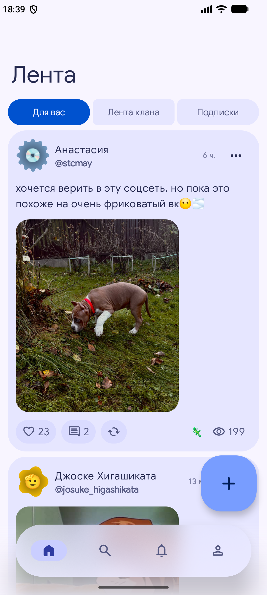
</picture>

<picture>
  <source media="(prefers-color-scheme: dark)" srcset="art/s2_dark.png">
  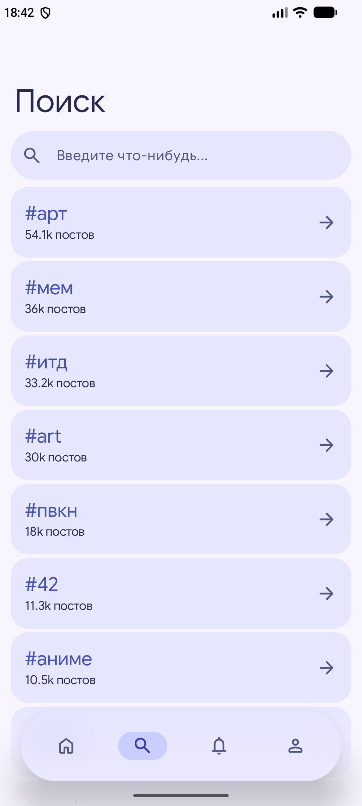
</picture>

<picture>
  <source media="(prefers-color-scheme: dark)" srcset="art/s3_dark.png">
  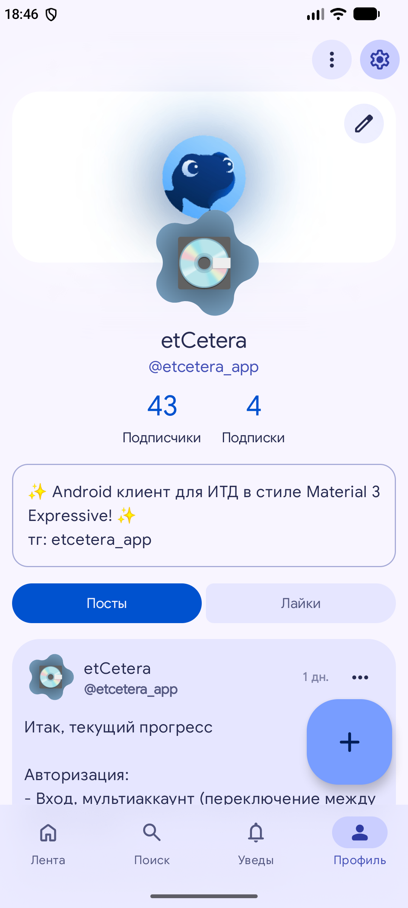
</picture>

<picture>
  <source media="(prefers-color-scheme: dark)" srcset="art/s4_dark.png">
  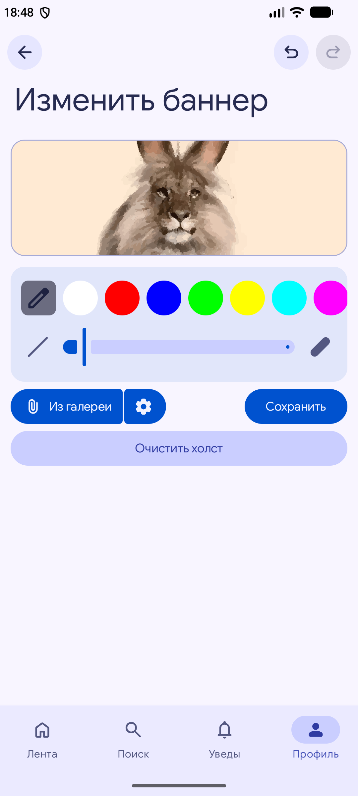
</picture>

<picture>
  <source media="(prefers-color-scheme: dark)" srcset="art/s5_dark.png">
  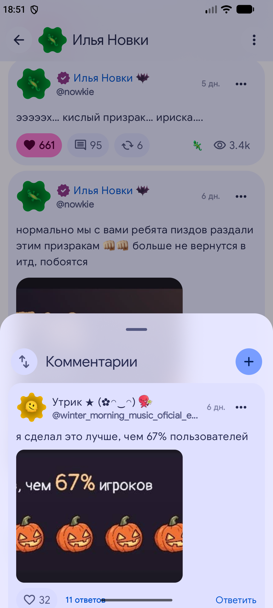
</picture>

<picture>
  <source media="(prefers-color-scheme: dark)" srcset="art/s6_dark.png">
  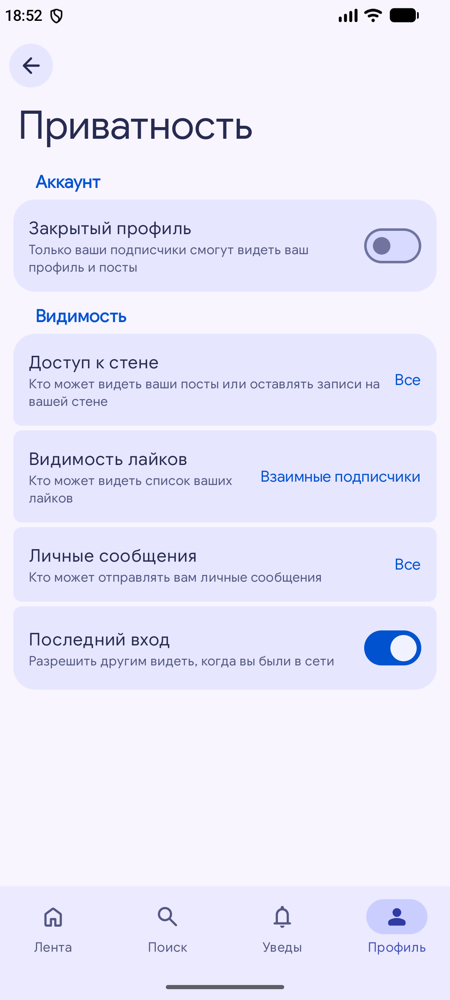
</picture>

<picture>
  <source media="(prefers-color-scheme: dark)" srcset="art/s7_dark.png">
  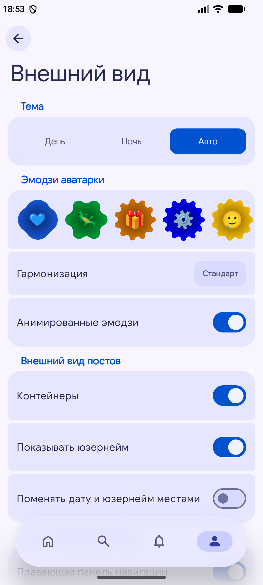
</picture>

<picture>
  <source media="(prefers-color-scheme: dark)" srcset="art/s8_dark.png">
  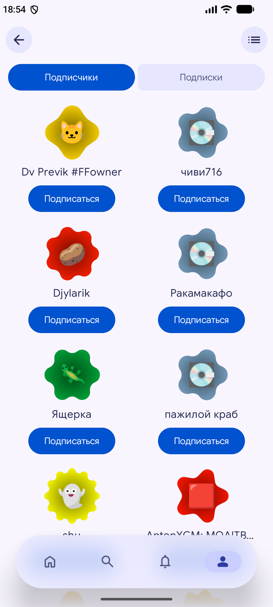
</picture>

<picture>
  <source media="(prefers-color-scheme: dark)" srcset="art/s9_dark.png">
  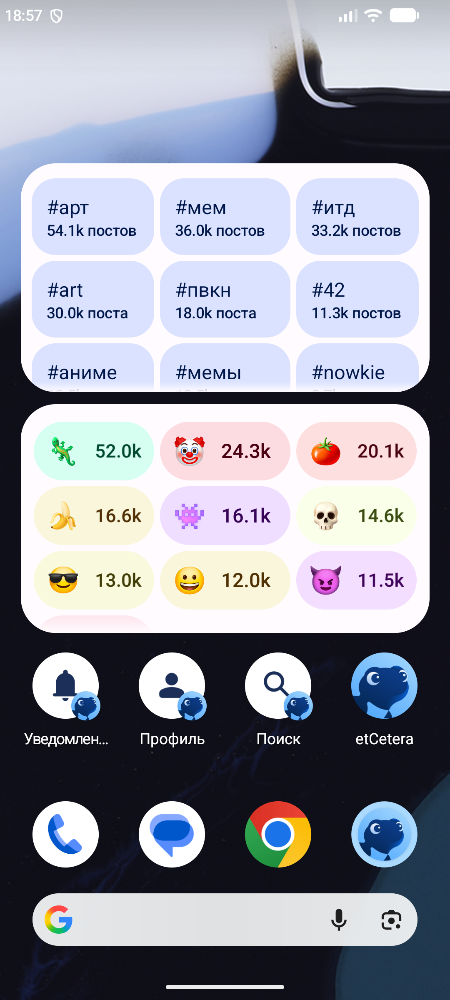
</picture>

<picture>
  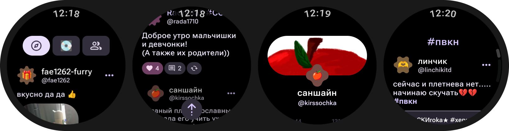
</picture>

</div>

## Сборка из исходников

Вам понадобятся:
- **JDK 21**
- **Android SDK 37** (API level 37)
1. Клонируйте репозиторий:
   ```bash
   git clone https://github.com/dertefter/etCeteraApp.git
   cd etCeteraApp
   ```

2. Сборка через командную строку:
    ```bash
    ./gradlew :app_mobile:assembleRelease
    ./gradlew :app_wearable:assembleRelease
    ```   
    Или используйте Android Studio.
    
    Готовые APK-файлы можно найти в директориях
    `app_mobile/build/outputs/apk/` и `app_wearable/build/outputs/apk/`.


## Лицензия
[Apache License 2.0](LICENSE)

## 🙏 Благодарности 🙏
- [itd-frontend](https://github.com/itd-sdk/itd-frontend) [(fi-res)](https://github.com/fi-res)
- Всем тестировщикам альфа/бета версий, а также участникам [Telegram-канала](https://t.me/etcetera_app) за отзывы и отчёты об ошибках
- [Cola Bochkari](https://bochkari.ru/brand-portfolio/beverages/cola_bochkari/) (за то, что она очень вкусная!)

## Поддержать меня
[https://dalink.to/dertefter](https://dalink.to/dertefter)
